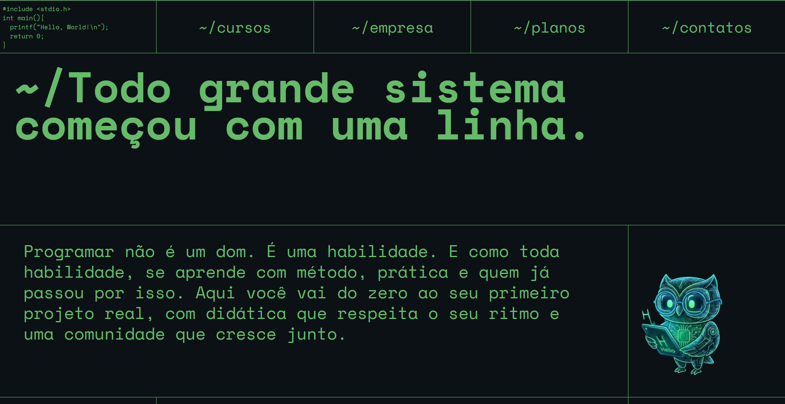
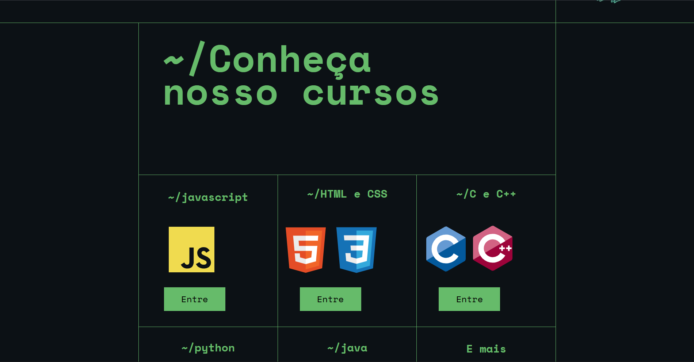
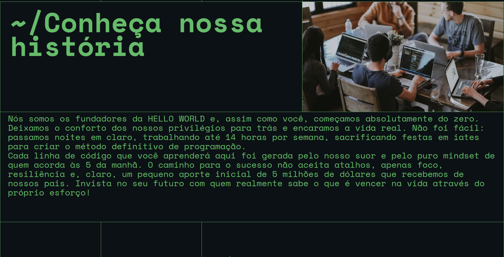
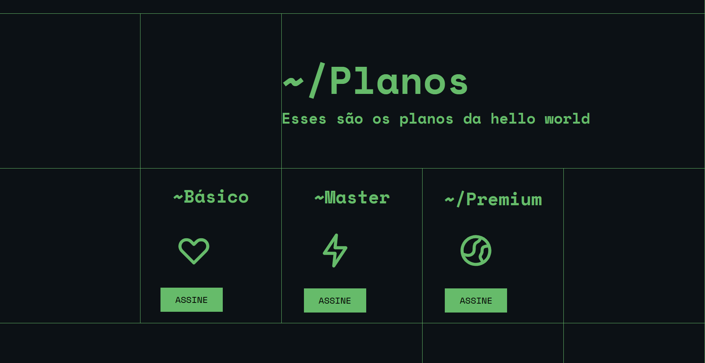
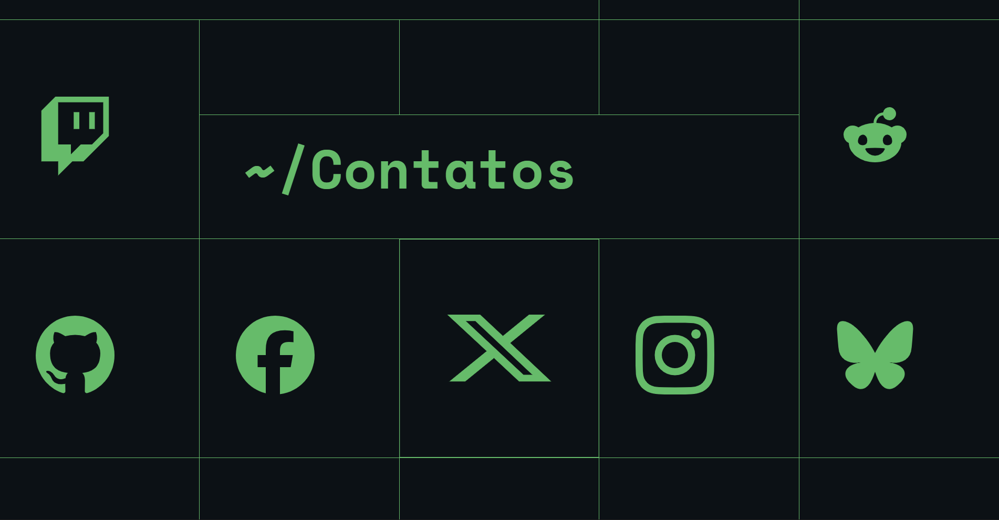
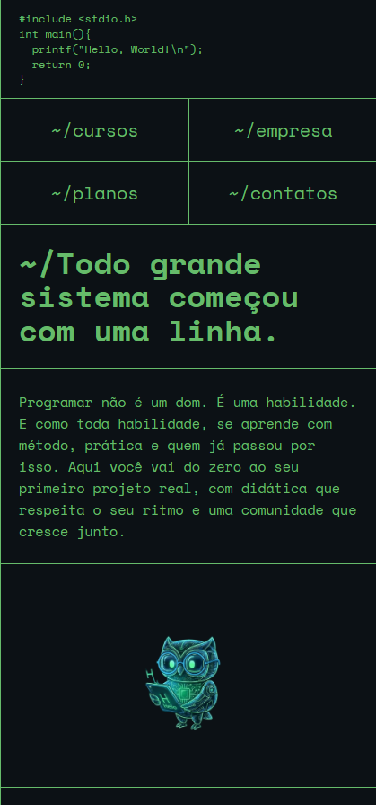
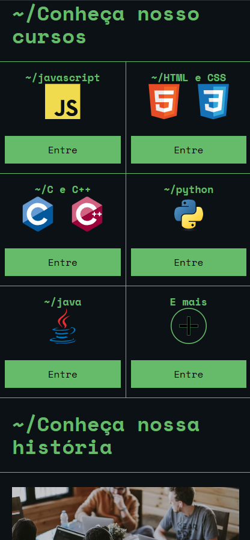
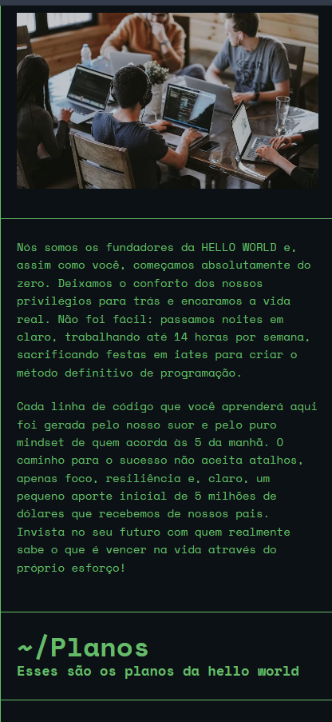
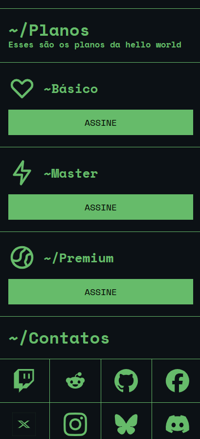

## Hello World

Site de uma escola de programação, feito como projeto de front-end.

---

## Identificação

- **Projeto:** Hello World
- **Aluno:** Saulo Amorim Galvão de Oliveira
- **Curso e turma:** Informática para a Internet, turma IFTP
- **Professor:** Josué Rodrigo Evangelista Figueirêdo

---

## Sobre o projeto

O Hello World é um site de uma escola de programação. Ele tem uma página só, com a apresentação da escola, os cursos, a história dos fundadores, os planos e os contatos nas redes sociais.

**Objetivo:** ajudar as pessoas a aprender programação. O site tenta mostrar que programar não é um dom, e sim uma habilidade que se aprende com prática, para quem não sabe por onde começar.

**Por que fiz:** por causa de uma lembrança de quando eu era pequeno e fiz um curso de programação em C. Meu primeiro código foi o *"Hello, World!"* no Code::Blocks. Por isso o logo do site é esse código e a escola se chama Hello World.

---

## Funcionalidades

- Menu no topo com links para as seções (cursos, empresa, planos e contatos), com rolagem suave
- Apresentação da escola com o mascote, uma coruja
- Seção de cursos com JavaScript, HTML e CSS, C e C++, Python, Java e "E mais"
- Cada botão "Entre" abre em outra aba a documentação da linguagem
- Seção com a história da escola, com uma foto e um texto engraçado sobre os fundadores
- Seção de planos com Básico, Master e Premium
- Seção de contatos com os ícones das redes sociais
- Layout que se adapta ao tamanho da tela. Em telas de até 1279 px o menu fica em duas colunas, os cursos ficam dois por linha e os planos ficam um embaixo do outro

## O que não foi feito

- Página de login. Não consegui fazer por causa da dificuldade em mexer nas células da tabela usada no layout
- O site não usa JavaScript
- Só o botão do plano Master leva para um site. Os botões dos planos Básico e Premium ainda não têm destino
- Os ícones das redes sociais ainda não têm links

---

## Tecnologias utilizadas

- HTML5
- CSS3, escrito dentro do próprio arquivo HTML
- Fontes Space Mono e JetBrains Mono, do [Google Fonts](https://fonts.google.com)
- Imagens SVG e PNG
- Editor de código: (colocar aqui o que usou, por exemplo Visual Studio Code)
- Git e GitHub

---

## Estrutura do projeto

| Arquivo ou pasta | Para que serve |
| --- | --- |
| index8.html | A página do site. Tem o HTML e o CSS |
| assets | Imagens e ícones usados no site |
| prints | Capturas de tela usadas neste README |
| README.md | Esta documentação |

---

## Como executar

Não precisa instalar nada.

1. Baixe o repositório (Code > Download ZIP) e extraia, ou clone com git
2. Deixe o arquivo index8.html na mesma pasta da pasta assets
3. Abra o index8.html em um navegador

É preciso internet para carregar as fontes do Google. Sem internet o site abre, mas com outra fonte.

---

## Demonstração

## Versão para computador

*Topo do site, com o logo, o menu, o título e o mascote*

*Seção de cursos, com os logos das linguagens e os botões "Entre"*

*Seção com a história da escola*

*Seção de planos*

*Seção de contatos, com as redes sociais*

## Versão para celular

*Topo do site no celular, com o menu em duas colunas*

*Cursos no celular, dois por linha*

*História da escola no celular*

*Planos e contatos no celular*

---

## Melhorias futuras

1. Fazer a página de login
2. Tirar o CSS de dentro do HTML e colocar em um arquivo separado
3. Usar JavaScript para deixar o site mais interativo
4. Colocar destino nos botões ASSINE dos planos Básico e Premium
5. Colocar links nos ícones das redes sociais